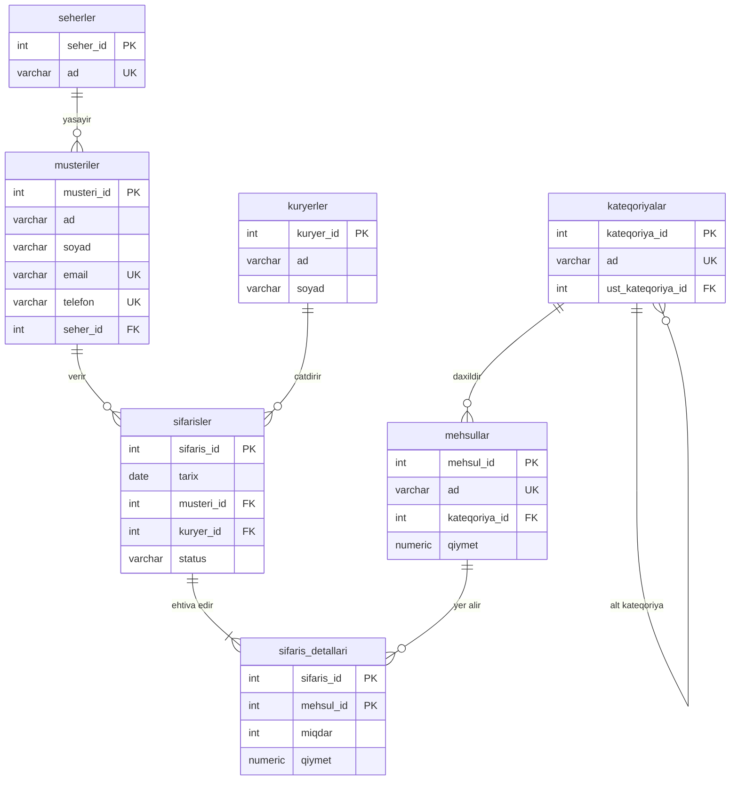

# OnlaynMağaza verilənlər bazası – SQL Praktiki Tapşırıq

**Ad, Soyad:** Ahmad Ahmadov **Qrup:** ____________________
**İstifadə olunan DBMS:** PostgreSQL

---

## Addım 1. Köhnə cədvəlin təhlili

### 1NF pozuntusu

`mehsullar`, `kateqoriya`, `qiymetler` və `miqdarlar` sütunlarında bir xanada bir neçə dəyər var (məsələn, 1-ci
sifarişdə `Noutbuk, Siçan`, `1500, 25`, `1, 2`). Bu, bir sıra problem yaradır:

- Hansı qiymətin hansı məhsula aid olduğu yalnız vergüllə ayrılmış dəyərlərin sırasından bilinir. Sıra bir az pozulsa,
  məlumat səhv oxunur.
- "Siçan neçə ədəd satılıb?" sualına SQL ilə düz cavab vermək olmur, əvvəl mətni parçalamaq lazım gəlir.
- Bu xanalara foreign key, `CHECK` və ya `UNIQUE` kimi məhdudiyyət qoymaq mümkün deyil.
- Qiymətlər mətn kimi saxlanılır, ona görə cəmləmək və ya müqayisə etmək olmur.

### 2NF pozuntusu

Cədvəli 1NF-ə gətirəndə hər sətir bir sifarişin bir məhsulu olur və açar `(sifaris_id, mehsul)` olur. Amma məhsulun
qiyməti və kateqoriyası açarın yalnız bir hissəsindən, yəni məhsuldan asılıdır. Məsələn, "Siçan" həm 1-ci, həm də 3-cü
sifarişdə var və hər dəfə `Aksesuar` və `25` yenidən yazılır. Bu, açarın bir hissəsindən asılılıqdır və 2NF-i pozur.

### 3NF pozuntusu

Tranzitiv asılılıqlar var:

- `sifaris_id → musteri → email, telefon, seher`. Bunlar sifarişin yox, müştərinin xüsusiyyətləridir.
- `sifaris_id → kuryer`. Kuryerin məlumatı da hər sifarişdə təkrar yazılır.
- `mehsul → kateqoriya`. Kateqoriya məhsuldan asılıdır, sifarişdən yox.

Məsələn, Aysel Məmmədova 1 və 3-cü sifarişdə var və email, telefon, şəhər hər ikisində təkrar yazılıb.

### Anomaliyalar

- **Insert:** Yeni müştəri qeydiyyatdan keçib, amma hələ sifariş verməyib. Sifarişsiz onu cədvələ yaza bilmərik. Eyni
  şey hələ satılmayan yeni məhsul üçün də keçərlidir.
- **Update:** Tural Həsənov telefonunu dəyişsə, onun bütün sətirlərini (2 və 5-ci sifariş) yeniləmək lazımdır. Birini
  unutsaq, eyni müştərinin iki fərqli nömrəsi qalar.
- **Delete:** 4-cü sifarişi silsək, Leyla Kərimova (onun yeganə sifarişidir) və Planşet məhsulu haqqında məlumat da
  bazadan itər. Sumqayıt şəhəri də bazada qalmaz.

---

## Addım 2. Normallaşdırılmış sxem

### Cədvəllər

**seherler**

| Sütun    | Tip         | Açar             |
|:---------|:------------|:-----------------|
| seher_id | SERIAL      | PK               |
| ad       | VARCHAR(50) | UNIQUE, NOT NULL |

**kateqoriyalar**

| Sütun             | Tip         | Açar               |
|:------------------|:------------|:-------------------|
| kateqoriya_id     | SERIAL      | PK                 |
| ad                | VARCHAR(50) | UNIQUE, NOT NULL   |
| ust_kateqoriya_id | INT         | FK → kateqoriyalar |

**musteriler**

| Sütun      | Tip          | Açar                    |
|:-----------|:-------------|:------------------------|
| musteri_id | SERIAL       | PK                      |
| ad         | VARCHAR(50)  | NOT NULL                |
| soyad      | VARCHAR(50)  | NOT NULL                |
| email      | VARCHAR(100) | UNIQUE, NOT NULL, CHECK |
| telefon    | VARCHAR(20)  | UNIQUE                  |
| seher_id   | INT          | FK → seherler           |

**mehsullar**

| Sütun         | Tip           | Açar                |
|:--------------|:--------------|:--------------------|
| mehsul_id     | SERIAL        | PK                  |
| ad            | VARCHAR(100)  | UNIQUE, NOT NULL    |
| kateqoriya_id | INT           | FK → kateqoriyalar  |
| qiymet        | NUMERIC(10,2) | NOT NULL, CHECK > 0 |

**kuryerler**

| Sütun     | Tip         | Açar     |
|:----------|:------------|:---------|
| kuryer_id | SERIAL      | PK       |
| ad        | VARCHAR(50) | NOT NULL |
| soyad     | VARCHAR(50) | NOT NULL |

**sifarisler**

| Sütun      | Tip         | Açar                                 |
|:-----------|:------------|:-------------------------------------|
| sifaris_id | SERIAL      | PK                                   |
| tarix      | DATE        | NOT NULL, DEFAULT CURRENT_DATE       |
| musteri_id | INT         | FK → musteriler                      |
| kuryer_id  | INT         | FK → kuryerler                       |
| status     | VARCHAR(20) | NOT NULL, DEFAULT 'Gözləmədə', CHECK |

**sifaris_detallari**

| Sütun      | Tip           | Açar                 |
|:-----------|:--------------|:---------------------|
| sifaris_id | INT           | PK, FK → sifarisler  |
| mehsul_id  | INT           | PK, FK → mehsullar   |
| miqdar     | INT           | NOT NULL, CHECK >= 1 |
| qiymet     | NUMERIC(10,2) | NOT NULL, CHECK > 0  |

### Əlaqələr

- `seherler` 1:N `musteriler`
- `kateqoriyalar` 1:N `mehsullar`
- `kateqoriyalar` 1:N `kateqoriyalar` (alt kateqoriya)
- `musteriler` 1:N `sifarisler`
- `kuryerler` 1:N `sifarisler`
- `sifarisler` N:M `mehsullar` (`sifaris_detallari` vasitəsilə)

### Niyə qiymət `sifaris_detallari`-də də saxlanılır?

Məhsulun qiyməti zamanla dəyişə bilər. Əgər qiyməti yalnız `mehsullar` cədvəlində saxlasaq, məhsulun qiyməti dəyişəndə
köhnə sifarişlərin məbləği də dəyişər və keçmiş hesabatlar səhv çıxar. Ona görə sifariş anındakı qiymət ayrıca yazılır.

### ER diaqramı

Aşağıdakı kodu [mermaid.live](https://mermaid.live) və ya draw.io-ya yapışdırıb şəkil kimi export edə bilərsiniz.

---

## Addım 3–7. SQL kodu və nəticələr

| Addım | Fayl                   | Ekran görüntüsü               |
|:------|:-----------------------|:------------------------------|
| 3     | `01_create_tables.sql` | (əlavə edin)                  |
| 4     | `02_insert_data.sql`   | (xəta mesajlarının şəkilləri) |
| 5     | `03_join_queries.sql`  | (5.1–5.6 nəticələri)          |
| 6     | `04_cte_queries.sql`   | (6.1–6.5 nəticələri)          |
| 7     | `05_functions.sql`     | (7.1–7.6 nəticələri)          |

### Addım 4 – Constraint yoxlaması

| Sorğu                              | Xəta                                                                       | İşləyən constraint   |
|:-----------------------------------|:---------------------------------------------------------------------------|:---------------------|
| Mənfi qiymətli məhsul              | violates check constraint "chk_mehsul_qiymet"                              | `chk_mehsul_qiymet`  |
| Təkrar email                       | duplicate key value violates unique constraint "uq_musteri_email"          | `uq_musteri_email`   |
| Mövcud olmayan müştəri ID-si (999) | violates foreign key constraint "fk_sifaris_musteri"                       | `fk_sifaris_musteri` |
| Status = 'Yolda'                   | violates check constraint "chk_sifaris_status"                             | `chk_sifaris_status` |
| Sifarişi olan müştərini silmək     | violates foreign key constraint "fk_sifaris_musteri" on table "sifarisler" | `ON DELETE RESTRICT` |

---

## Addım 8. Nəticə

Normallaşdırmadan sonra hər məlumat bazada yalnız bir yerdə saxlanılır. Məsələn, müştərinin telefonu dəyişəndə bir sətri
yeniləmək kifayət edir. Constraint-lər sayəsində səhv məlumat (mənfi qiymət, təkrar email, yanlış status) bazaya daxil
ola bilmir. Sifarişi olmayan müştəri və ya satılmayan məhsul artıq problem yaratmır, çünki onlar ayrıca cədvəllərdə
saxlanılır. Sifariş detallarında qiymətin ayrıca saxlanması köhnə hesabatların düzgün qalmasını təmin edir. JOIN, CTE və
funksiyalarla hesabatları hazırlamaq da xeyli asanlaşdı, çünki bütün dəyərlər ayrı sütunlardadır. Ümumilikdə baza həm
daha səliqəli, həm də genişləndirilməsi asan oldu.
