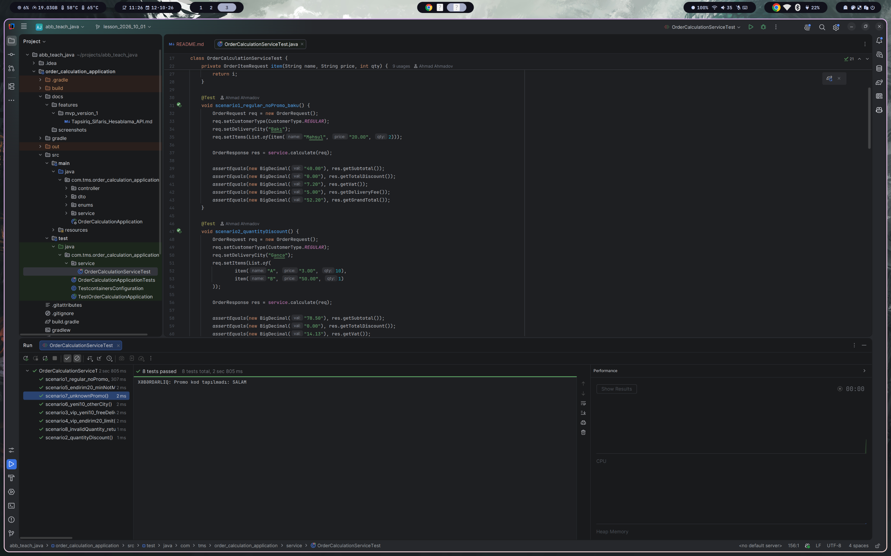

# Sifariş Hesablama API

Sifarişin yekun məbləğini hesablayan Spring Boot tətbiqi. Endirimlər, ƏDV və çatdırılma haqqı qaydalara uyğun ardıcıllıqla hesablanır. Verilənlər bazası yoxdur, bütün məntiq service qatındadır, nəticə DTO kimi qaytarılır.

Tapşırığın tam mətni: [docs/features/mvp_version_1/Tapsiriq_Sifaris_Hesablama_API.md](docs/features/mvp_version_1/Tapsiriq_Sifaris_Hesablama_API.md)

## Texnologiyalar

- Java 26 (Gradle toolchain)
- Spring Boot 4.1.1 (Web MVC)
- Springdoc OpenAPI (Swagger UI)
- JUnit 5
- Gradle

## İşə salmaq

```bash
./gradlew bootRun
```

Tətbiq `http://localhost:8080` ünvanında açılır.

Swagger UI: `http://localhost:8080/swagger-ui.html`

## Testləri işə salmaq

```bash
./gradlew test --tests "com.tms.order_calculation_application.service.OrderCalculationServiceTest"
```

`OrderCalculationServiceTest` tapşırıqdakı 8 ssenarinin hamısını yoxlayır.

## Layihə strukturu

```
src/main/java/com/tms/order_calculation_application
├── controller
│   └── OrderController.java          # Endpoint-lər, sorğunu service-ə ötürür
├── dto
│   ├── request
│   │   ├── OrderRequest.java         # Sifariş sorğusu
│   │   └── OrderItemRequest.java     # Sorğudakı bir məhsul sətri
│   └── response
│       ├── OrderResponse.java        # Hesablamanın nəticəsi
│       ├── OrderItemResponse.java    # Nəticədəki bir məhsul sətri
│       └── PromoCodeResponse.java    # Promo kod siyahısı üçün
├── enums
│   ├── CustomerType.java             # REGULAR, VIP
│   └── PromoCode.java                # YENI10, ENDIRIM20
└── service
    ├── OrderCalculationService.java  # Bütün hesablama və yoxlama məntiqi
    └── promo
        ├── PromoStrategy.java        # Promo kod interfeysi
        ├── Yeni10PromoStrategy.java
        ├── Endirim20PromoStrategy.java
        └── PromoService.java         # Promo kodların siyahısı
```

## Endpoint-lər

| Metod | URL | Təyinatı |
| --- | --- | --- |
| POST | `/sima-sign/api/orders/calculate` | Sifarişi hesablayır |
| GET | `/sima-sign/api/orders/promo-codes` | Mövcud promo kodları və şərtlərini qaytarır |

### Sorğu nümunəsi

```json
{
  "customerType": "VIP",
  "promoCode": "YENI10",
  "deliveryCity": "Bakı",
  "items": [
    { "productName": "Qulaqlıq", "unitPrice": 150.00, "quantity": 2 }
  ]
}
```

### Cavab nümunəsi

```json
{
  "items": [
    {
      "productName": "Qulaqlıq",
      "unitPrice": 150.00,
      "quantity": 2,
      "lineTotal": 300.00,
      "quantityDiscount": 0.00,
      "finalLineTotal": 300.00
    }
  ],
  "subtotal": 300.00,
  "customerDiscount": 45.00,
  "promoDiscount": 30.00,
  "totalDiscount": 75.00,
  "amountAfterDiscount": 225.00,
  "vat": 40.50,
  "deliveryFee": 0.00,
  "grandTotal": 265.50,
  "appliedRules": ["VIP endirimi 15%", "YENI10 promo kodu 10%", "Pulsuz çatdırılma"]
}
```

## Hesablama qaydaları

Qaydalar bu ardıcıllıqla tətbiq olunur. Bütün məbləğlər AZN-dir və `BigDecimal` ilə hesablanır, hər məbləğ `setScale(2, RoundingMode.HALF_UP)` ilə yuvarlaqlaşdırılır.

1. **Sətir məbləği:** `lineTotal = unitPrice × quantity`
2. **Say endirimi:** `quantity ≥ 10` olarsa, sətrə 5% endirim
3. **Subtotal:** bütün sətirlərin `finalLineTotal` cəmi
4. **Müştəri endirimi:** VIP üçün subtotal-ın 15%-i
5. **Promo kod:** YENI10 subtotal-ın 10%-i; ENDIRIM20 sabit 20.00 AZN (subtotal ≥ 100.00 olduqda)
6. **Endirim limiti:** ümumi endirim subtotal-ın 30%-dən çox ola bilməz
7. **Endirimdən sonra:** `amountAfterDiscount = subtotal − totalDiscount`
8. **ƏDV:** `amountAfterDiscount × 18%`
9. **Çatdırılma:** ≥ 200.00 olarsa pulsuz; Bakı (`Bakı`, `BAKI`, `Baku`) üçün 5.00, digər şəhərlər üçün 10.00
10. **Yekun:** `grandTotal = amountAfterDiscount + vat + deliveryFee`

## Xəta halları

Exception istifadə olunmur. Yanlış girişdə service konsola mesaj yazır və `null` qaytarır, endpoint boş cavab verir.

| Hal | Konsol mesajı |
| --- | --- |
| items boşdur | XƏTA: Sifarişdə ən azı bir məhsul olmalıdır |
| productName boşdur | XƏTA: Məhsulun adı boş ola bilməz |
| quantity < 1 | XƏTA: Say 1-dən kiçik ola bilməz |
| unitPrice ≤ 0 | XƏTA: Qiymət 0-dan böyük olmalıdır |
| customerType yoxdur | XƏTA: Müştəri tipi mütləqdir |
| deliveryCity boşdur | XƏTA: Çatdırılma şəhəri mütləqdir |
| Naməlum promo kod | XƏBƏRDARLIQ: Promo kod tapılmadı: SALAM (hesablama davam edir) |

## Test ssenariləri

| # | Sorğu | subtotal | endirim | vat | çatdırılma | grandTotal |
| --- | --- | --- | --- | --- | --- | --- |
| 1 | REGULAR, promo yox, Bakı; 20.00 × 2 | 40.00 | 0.00 | 7.20 | 5.00 | 52.20 |
| 2 | REGULAR, promo yox, Gəncə; 3.00 × 10 və 50.00 × 1 | 78.50 | 0.00 | 14.13 | 10.00 | 102.63 |
| 3 | VIP, YENI10, Bakı; 150.00 × 2 | 300.00 | 75.00 | 40.50 | 0.00 | 265.50 |
| 4 | VIP, ENDIRIM20, Bakı; 25.00 × 4 | 100.00 | 30.00 | 12.60 | 5.00 | 87.60 |
| 5 | REGULAR, ENDIRIM20, Bakı; 30.00 × 3 | 90.00 | 0.00 | 16.20 | 5.00 | 111.20 |
| 6 | REGULAR, YENI10, Sumqayıt; 220.00 × 1 | 220.00 | 22.00 | 35.64 | 10.00 | 243.64 |
| 7 | REGULAR, SALAM, Bakı; 10.00 × 1 | 10.00 | 0.00 | 1.80 | 5.00 | 16.80 |
| 8 | REGULAR, promo yox, Bakı; 10.00 × 0 | - | - | - | - | boş cavab |

## Ekran görüntüləri

Şəkilləri `docs/screenshots/` qovluğuna əlavə edin.

### Caselər


## Bonus

- [x] JUnit testləri: 8 ssenarinin hamısı `OrderCalculationServiceTest`-də
- [x] Strategy pattern: hər promo kod `PromoStrategy` interfeysini implement edən ayrıca sinifdir
- [x] Promo kodların siyahısı üçün GET endpoint
